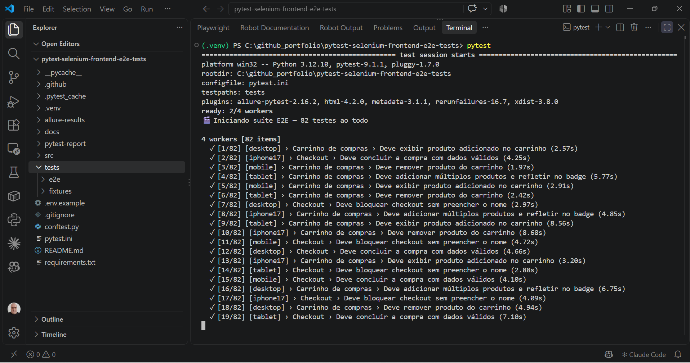
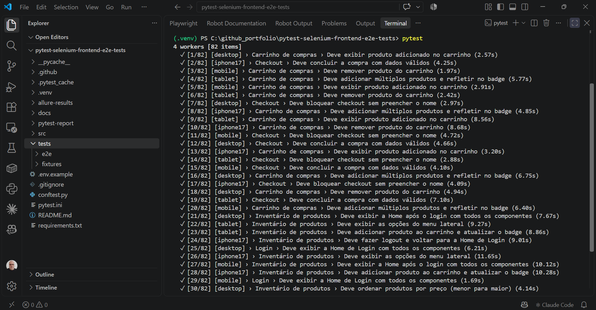
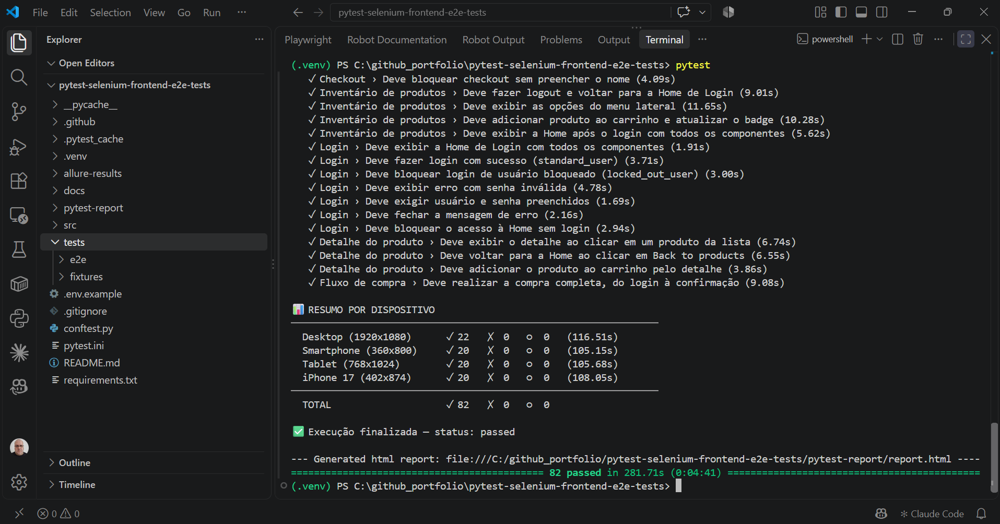
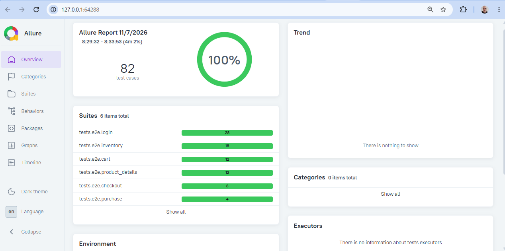
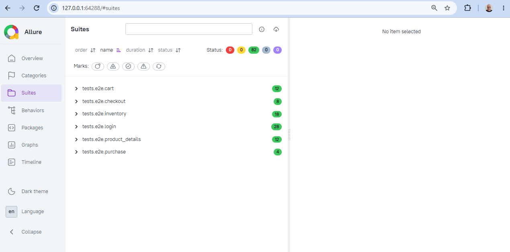
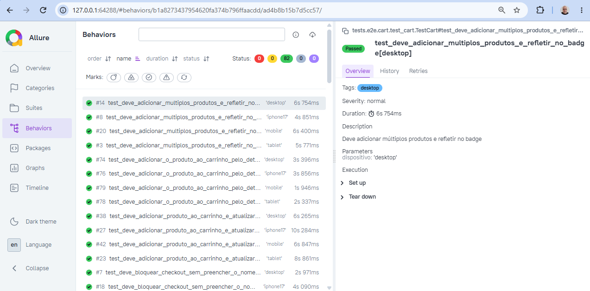
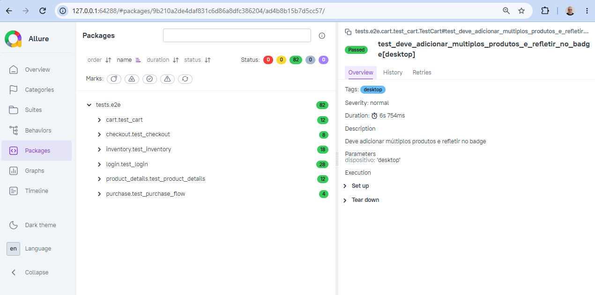
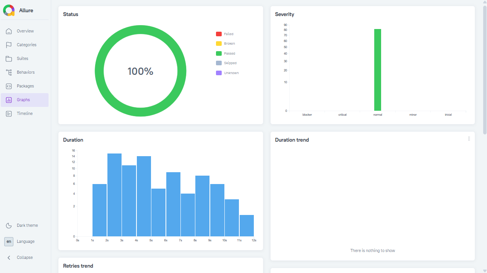

# Pytest Selenium Frontend E2E Tests

Suíte de testes E2E **multi-dispositivo e responsivo** (Desktop, Tablet, Smartphone e iPhone 17), com Python, Pytest e Selenium WebDriver, em Page Object Model, contra o [SauceDemo](https://www.saucedemo.com) — um site público mantido pela Sauce Labs especificamente para prática de automação de testes.


## 🚀 Como Começar

```bash
# 1. Clone o repositório
git clone https://github.com/moiseschiaretto/pytest-selenium-frontend-e2e-tests.git
cd pytest-selenium-frontend-e2e-tests

# 2. Crie e ative o ambiente virtual
python -m venv .venv
.venv\Scripts\activate        # Windows
source .venv/bin/activate     # Linux e macOS

# 3. Instale as dependências
pip install -r requirements.txt

# 4. Rode os testes (os 4 dispositivos, 4 testes em paralelo)
pytest
```

Requisito: Google Chrome instalado. O Selenium Manager (já incluído no Selenium) baixa automaticamente o ChromeDriver compatível com a versão do Chrome.

```bash
# Rode por dispositivo (valida o layout responsivo em cada breakpoint):
pytest -k desktop
pytest -k mobile
pytest -k tablet
pytest -k iphone17

# Abra o navegador na tela para acompanhar a execução
pytest --headed -n 1
```

Relatório padrão (pytest-html): `pytest-report/report.html`, gerado a cada execução do `pytest`. Basta abrir o arquivo no navegador.

## Relatório Allure

```bash
pytest                                                                  # roda os testes + gera allure-results/
npx allure-commandline generate allure-results --clean -o allure-report  # gera o relatório Allure
npx allure-commandline open allure-report                                # sobe um servidor local e abre o relatório no navegador
```

(gera o relatório final via `allure-commandline`, sem precisar instalar o Allure no sistema; requer Node.js e Java)

> ⚠️ **Não abra `allure-report/index.html` direto no navegador** (duplo clique / `file://`). O Allure carrega os dados via requisições JS, que o Chrome/Firefox bloqueiam por segurança quando o arquivo é aberto localmente sem servidor — a página abre em branco. Use sempre:
> ```bash
> npx allure-commandline open allure-report
> ```

A pasta `allure-results/` é limpa automaticamente a cada execução do `pytest` (opção `--clean-alluredir` no `pytest.ini`).

### 📸 Execução dos testes

**Terminal (VSCode) — início da execução, com os 4 processos em paralelo:**



**Terminal (VSCode) — cada teste exibido assim que termina, com dispositivo, tela e tempo:**



**Terminal (VSCode) — 82 testes passando, agrupados por dispositivo no resumo final:**



### 📸 Relatório Allure em execução

**Visão geral — 82 casos de teste, 100% de sucesso:**



**Suítes — testes organizados por tela (login, inventory, cart, product_details, checkout, purchase):**



**Comportamentos — cada cenário executado nos 4 dispositivos, com descrição, dispositivo e duração:**



**Pacotes — testes agrupados por arquivo de teste:**



**Gráficos — status, gravidade e duração dos testes:**



---

## Por que o SauceDemo como alvo

Diferente de um site comercial real, o SauceDemo é **construído pela Sauce Labs deliberadamente para não mudar** — é o "ambiente de prática" oficial da própria empresa por trás do Sauce Labs, usado por milhares de squads de QA no mundo todo para aprender e demonstrar automação. Isso significa:

- Sem risco de o layout mudar e quebrar os testes do dia pra noite
- Sem bloqueio anti-bot (ao contrário de sites comerciais reais)
- Usuários de teste **documentados oficialmente na própria tela de login** (`standard_user`, `locked_out_user`, `problem_user`, `performance_glitch_user`, `error_user`, `visual_user` — todos com a senha `secret_sauce`), o que permite testar cenários de autenticação variados (sucesso, bloqueio, erro) sem precisar de conta própria

## O que este projeto cobre

- **Home de Login** — validação da tela (URL, título e componentes), sucesso, usuário bloqueado, senha inválida, campos obrigatórios, fechar a mensagem de erro e bloqueio de acesso sem login
- **Home após o Login (Inventário)** — validação da tela e dos 6 produtos (nome, descrição, preço, imagem e botão), adicionar ao carrinho, ordenação (preço e nome), menu lateral e logout
- **Detalhe do produto** — validação da tela, consistência com a lista (nome, descrição e preço), voltar para a lista e adicionar ao carrinho
- **Carrinho** — validação da tela, exibir e remover produtos, contagem de itens e contador do carrinho
- **Checkout** — validação das três telas (dados, resumo e compra concluída) e campo obrigatório
- **Fluxo de compra** — jornada completa pela interface, do login à compra concluída

## Arquitetura

```
conftest.py                          # navegador por dispositivo, sessão de login, captura de tela na falha e relatório de console
pytest.ini                           # configuração do Pytest (caminho de importação, marcadores, paralelismo e relatórios)
requirements.txt                     # dependências do projeto
src/
  pages/                             # Page Object Model — locators como propriedades
    base_page.py                     # driver privado e esperas com validação (URL, título, texto, quantidade, atributo)
    components/
      header_component.py            # cabeçalho comum: logo, menu lateral, carrinho e contador
      footer_component.py            # rodapé comum: redes sociais e copyright
    login/login_page.py
    inventory/inventory_page.py
    product_details/product_details_page.py
    cart/cart_page.py
    checkout/
      checkout_information_page.py   # etapa 1: dados de entrega
      checkout_overview_page.py      # etapa 2: resumo do pedido
      checkout_complete_page.py      # etapa 3: compra concluída
  constants/
    routes.py                        # rotas, slugs, nomes e ids de produto
    texts.py                         # textos esperados nas telas (títulos, botões, menu, mensagens)
  config/
    environments.py                  # URL base do site público
    devices.py                       # os 4 dispositivos: resolução, densidade, toque e user agent
  helpers/
    credentials.py                   # usuários de demonstração (públicos, documentados)
    cart_helper.py                   # monta o carrinho no localStorage antes de abrir a tela
  support/
    browser.py                       # abre o Chrome com a área visível exata do dispositivo
    session.py                       # login único, reaproveitado entre testes pelos cookies da sessão
    test_data.py                     # validação Pydantic dos dados de teste (test_data.json)
tests/
  e2e/
    login/test_login.py
    inventory/test_inventory.py
    product_details/test_product_details.py
    cart/test_cart.py
    checkout/test_checkout.py
    purchase/test_purchase_flow.py   # jornada completa pela interface
  fixtures/
    test_data.example.json           # template versionado
    test_data.json                   # dados reais (fora do versionamento — convenção mesmo sem dado sensível)
docs/
  screenshots/                       # capturas de tela da execução e do relatório Allure
```

## Validação de tela

Toda Page Object tem o método `validar_tela()`, chamado sempre que o teste chega a uma tela. Antes de qualquer ação, o teste confirma que está na tela certa, com três checagens:

1. **URL** — a rota da tela (ex.: `/inventory.html`, `/inventory-item.html?id=4`)
2. **Título** — o título da aba ("Swag Labs") e o título da tela (ex.: "Products", "Your Cart", "Checkout: Overview"). A tela de detalhe não tem título fixo: o nome do produto é o título
3. **Componentes** — os elementos que só existem naquela tela (campos, botões, lista de produtos, cabeçalho e rodapé)

Se a sessão cair e o site voltar para o login, o teste falha na validação da tela, com a causa real, e não depois, num seletor sem relação com o problema.

## Estratégia de início dos testes

- **Login uma única vez por processo paralelo** — a primeira vez que um teste autenticado precisa da sessão, o login é feito pela interface (validando a Home de Login e a Home após o login) e os cookies são guardados. Os demais testes daquele processo reaproveitam a sessão e entram direto na tela testada
- **Começar o mais perto possível da tela testada** — carrinho e checkout montam o carrinho direto no localStorage do navegador (chave `cart-contents`, onde a SauceDemo guarda o carrinho) e abrem a própria tela, sem passar pela lista de produtos
- **Uma jornada completa pela interface** — o `test_purchase_flow.py` percorre login, lista, detalhe, carrinho, dados, resumo e compra concluída, cobrindo o caminho do usuário de ponta a ponta
- **Testes independentes** — cada teste abre o próprio navegador e cria o próprio estado, e todos rodam em paralelo (`pytest-xdist`)

## Convenções de código aplicadas

- **Seletores `data-test`** — atributos que a própria SauceDemo publica para automação, mais estáveis que classes CSS
- **Seletores só nos Page Objects** — nenhum teste usa `find_element` ou `driver.get` diretamente; cada página tem `abrir()` e `validar_tela()`
- **Imports a partir da raiz** (`from src.pages.login.login_page import LoginPage`), com `pythonpath = .` no `pytest.ini`, sem caminhos relativos
- **Locators como `@property`** — sempre retornam o localizador, e o elemento é buscado de novo a cada espera, evitando referências obsoletas
- **Zero valor hardcoded** em teste ou Page Object — rotas, slugs e ids vêm de `routes.py`, textos esperados vêm de `texts.py`, dados de massa vêm de `test_data.json` validado via Pydantic
- **Testes deslogados** usam o marcador `@pytest.mark.deslogado`
- **Proibido `time.sleep`** — todas as esperas usam `WebDriverWait` com condição explícita e mensagem clara do que era esperado e do que foi encontrado
- **Captura de tela na falha** — anexada automaticamente ao Allure e ao relatório padrão

## Multi-dispositivo e responsivo

Cada teste roda uma vez em cada dispositivo. A área visível é aplicada pelo protocolo do Chrome (CDP), com resolução, densidade de pixels, toque e user agent exatos:

| Dispositivo | Resolução | Densidade | Toque |
|---|---|---|---|
| `desktop` | Desktop (1920x1080) | 1 | não |
| `mobile` | Smartphone (360x800) | 2,75 | sim |
| `tablet` | Tablet (768x1024) | 1 | não |
| `iphone17` | iPhone 17 (402x874) | 3 | sim |

### Marcadores de dispositivo

- `@pytest.mark.desktop_only` — roda só no `desktop` (ex.: teste de ordenação, que depende de um dropdown pouco usável em mobile)
- `@pytest.mark.compact_only` — roda só em `mobile`, `tablet` e `iphone17`
- sem marcador — roda em todos os dispositivos

## Dados sensíveis

Este projeto **não usa nenhum dado de cliente real** — nem endpoint, nem credencial, nem estrutura de negócio proprietária. Tudo aqui roda contra a instância pública do SauceDemo, com usuários de demonstração oficialmente documentados pela Sauce Labs.

## CI

O workflow (`.github/workflows/e2e-tests.yml`) roda a cada push/PR na `main` e também toda segunda-feira — a execução semanal serve como um "canário": se o SauceDemo mudar algo inesperado, o CI avisa antes de você precisar descobrir na próxima vez que abrir o projeto. Os relatórios ficam disponíveis como artefatos da execução.
